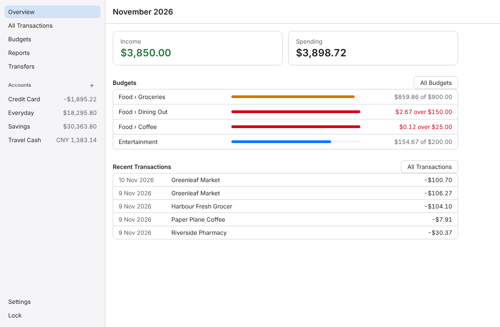
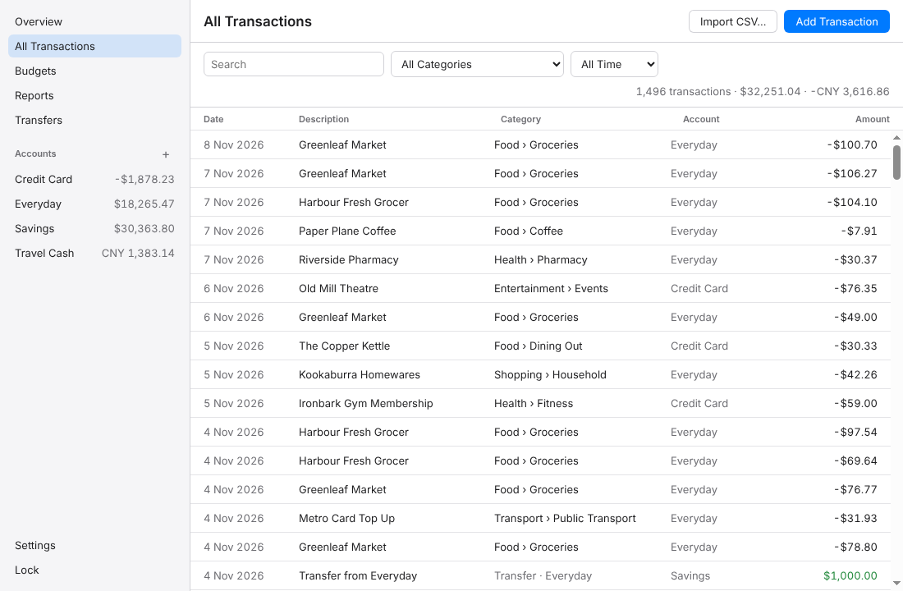
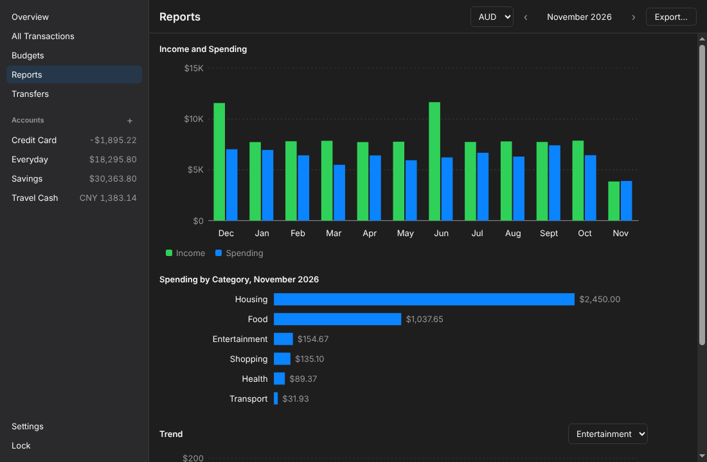
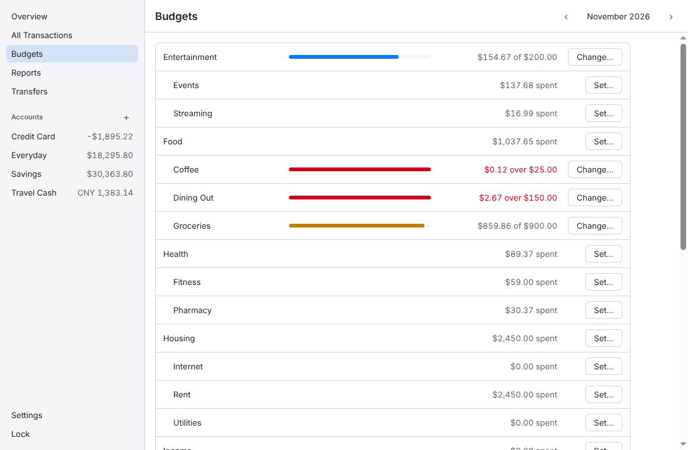
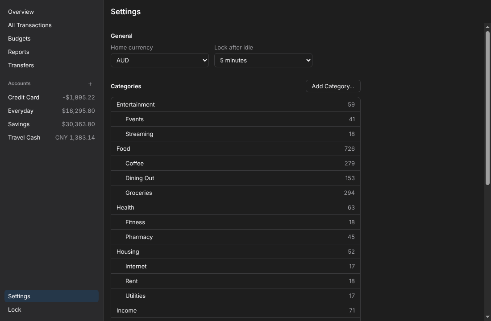
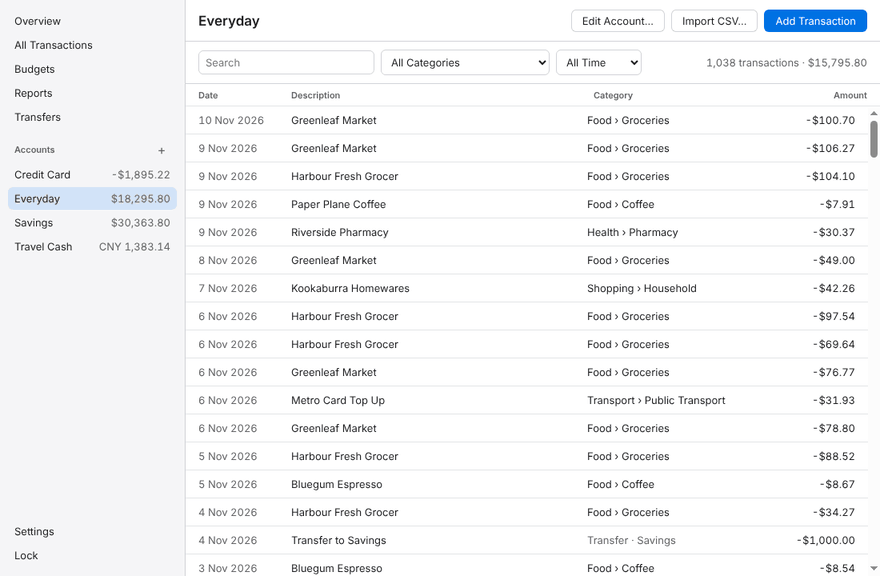

# Local Ledger

A personal finance desktop app for macOS and Windows that keeps everything on your computer, in an encrypted database. Import bank CSV files, categorize transactions with rules, set monthly budgets, see charts, and export a month to Excel or PDF. The app makes no network requests.



| | |
| --- | --- |
|  |  |
|  |  |



The screenshots show made-up data from `npm run seed`.

## What it does

- **Encrypted vault.** One master password protects everything. It derives a key with Argon2id that unlocks the data key; the database is encrypted with SQLCipher. The vault locks after a set idle time (1 to 30 minutes), when the screen locks, and when the computer sleeps. There is no password recovery.
- **Import.** CSV files from any bank, through a column wizard; CommBank, NAB, ANZ and Westpac files are recognized without it. Choose a file or drop it on the window. Duplicates are skipped, likely duplicates are left unselected, and an import can be undone; undoing one keeps the transactions a later import also contained, provided that import added at least one new transaction.
- **Categories and rules.** Rules categorize imported rows by their description. Transfers between your own accounts are paired and left out of income and spending.
- **Budgets and reports.** A monthly budget per category in your home currency, twelve months of income and spending, spending by category, and a category's trend.
- **Exports.** A month's statement as an Excel workbook or a PDF. **Exported files are not encrypted.**
- **Backups.** An encrypted `.llbackup` file of the whole vault, which opens only with the master password it was made under. Restoring one keeps the replaced vault beside it. A locked vault, or one that no longer opens, can be replaced from a backup with the backup's password.

## Install

Download the installer for your system from [Releases](https://github.com/shyanorn/local-ledger/releases): `mac-arm64.dmg` for Macs with an M-series chip, `mac-x64.dmg` for Intel Macs, `windows-x64-setup.exe` for Windows.

The builds are not signed with a paid developer certificate ([D006](docs/DECISIONS.md#d006-unsigned-releases-without-auto-update)), so each system warns the first time you open the app.

**macOS.** Opening the app the first time shows "Local Ledger" cannot be opened, or that it could not be verified, with no option to open it. Close the message, then go to System Settings → Privacy & Security, scroll to Security, and click **Open Anyway** next to the message about Local Ledger. Confirm with your login password. After that, the app opens normally.

**Windows.** The installer shows "Windows protected your PC" (Microsoft Defender SmartScreen). Click **More info**, check that the app is `local-ledger-…-setup.exe`, then **Run anyway**. If Smart App Control is on, Windows blocks unsigned apps entirely and offers no way to allow just this one.

There is no automatic update. Help → Check for Updates… opens the Releases page.

### Verify a download

Each release lists the SHA-256 of every file in `SHA256SUMS` and carries a build provenance attestation that ties each file to the workflow run that built it:

```bash
sha256sum -c SHA256SUMS --ignore-missing          # macOS: shasum -a 256 -c SHA256SUMS --ignore-missing
gh attestation verify local-ledger-<version>-mac-arm64.dmg --repo shyanorn/local-ledger
```

On Windows, `Get-FileHash .\local-ledger-<version>-windows-x64-setup.exe` in PowerShell prints the SHA-256 to compare with the line in `SHA256SUMS`.

## Importing bank files

The CommBank, NAB, ANZ and Westpac layouts come from open-source parsers and their published sample files, since the banks do not document them. They have not been checked against real exports; a file the app does not recognize opens in the column wizard.

If a bank file is not read correctly, `npm run csv:shape -- <file.csv>` prints a report of its structure (columns, date and amount formats, encoding) that contains none of its data, to attach to an issue.

## Known limits

- Excel and Numbers have not been tried with exported workbooks; LibreOffice opens them correctly.
- The macOS translucent sidebar has not been seen on a real Mac.
- Budgets count one home currency; amounts in other currencies are listed, never converted.
- Exported files, and the CSV files you import, stay unencrypted wherever you keep them.
- A vault opened by version 0.2.0 no longer opens in 0.1.0: its database moves to schema version 8 and `vault.json` gains a checksum the older version refuses. Make a backup with 0.1.0 before upgrading.
- Imports made before version 0.2.0 kept no record of the rows they skipped as duplicates: undoing an earlier import still removes the transactions such an import also contained.

## Development

```bash
npm ci && npm run setup:electron   # install scripts are off (.npmrc)
npm run dev
npm test                           # unit tests
npm run test:e2e                   # end-to-end, Playwright for Electron
npm run lint && npm run typecheck && npm run format:check
npm run seed && npm run demo       # the app on a vault of made-up data
npm run build                      # installers for this platform
npm run screenshots                # the images above, from made-up data
```

On Linux, run the end-to-end tests as a non-root user under `xvfb-run`.

## Docs

- [Specification](docs/SPEC.md)
- [Security design](docs/SECURITY_DESIGN.md)
- [Design decisions](docs/DECISIONS.md)
- [Tasks](docs/TASKS.md)

## License

MIT
